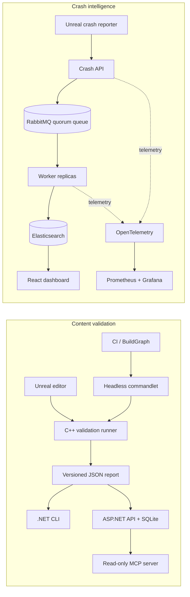

# PipelineGuard

[](https://github.com/MarvelousJade/PipelineGuard/actions/workflows/dotnet.yml)

**Unreal Engine content validation and crash intelligence—from editor checks to an observable operations stack.**

PipelineGuard catches content issues before they reach CI, produces deterministic reports for people and automation, and groups Unreal crash reports into searchable incidents. It combines an Unreal Engine 5.6 plugin with .NET 8 services, a constrained MCP interface, and a containerized crash-processing pipeline.

## What it does

| Content validation | Crash intelligence |
| --- | --- |
| Runs the same C++ validation rules in an editor panel or headless commandlet | Accepts bounded crash reports through an ASP.NET Core API |
| Checks naming, paths, texture budgets, and DataTable structure | Queues durable events in RabbitMQ for horizontal workers |
| Produces a versioned JSON report with CI-safe exit codes | Normalizes call stacks and creates deterministic SHA-256 fingerprints |
| Summarizes and compares reports through a .NET CLI | Stores idempotent crash documents and groups them in Elasticsearch |
| Stores run history in SQLite and exposes four read-only MCP tools | Surfaces incidents through a React dashboard, OpenTelemetry, and Grafana |

## Architecture



## Engineering highlights

- **Contract-first boundary:** Unreal and .NET communicate through a strict, versioned JSON schema with cross-field validation and deterministic ordering.
- **Editor/CI parity:** one validation runner powers both interactive asset workflows and unattended commandlet execution.
- **Safe AI access:** MCP is read-only, API-backed, paginated, and bounded—no arbitrary filesystem or command execution.
- **Reliable event processing:** persistent publisher confirms, at-least-once delivery, bounded retries, dead-letter routing, and idempotent Elasticsearch writes.
- **Operational visibility:** traces, metrics, structured logs, health probes, provisioned dashboards, and alerts are included.
- **Portable verification:** GitHub Actions builds, audits, and tests the .NET and React surfaces on Windows and Linux.

## Verified results

| Verification | Observed result |
| --- | --- |
| Portable test suites | **58 passing tests** (49 validation + 9 crash intelligence) |
| Unreal Engine 5.6.1 | Editor target built; **4/4 automation tests** passed; commandlet and BuildGraph completed |
| Crash benchmark | **10,000 reports** accepted and grouped into the intended 100 deterministic fixture groups |
| Replay safety | Replaying all 10,000 messages created **zero duplicate Elasticsearch effects** |
| Search performance | **15.33 ms p95** across 100 filtered group searches |
| Worker recovery | 100 queued reports processed **9.43 s** after restart |

These are recorded local verification results, not production SLAs. The Unreal fixture host uses synthetic rule tests, and the benchmark environment and limitations are documented in the [verification record](docs/verification.md) and [benchmark evidence](docs/crash-intelligence/evidence/2026-08-08-compose-benchmark.md).

## Tech stack

- **Engine:** Unreal Engine 5.6, C++, Slate, commandlets, automation tests, BuildGraph
- **Backend:** .NET 8, ASP.NET Core, SQLite, RabbitMQ, Elasticsearch
- **Frontend:** React, TypeScript, Vite
- **Observability:** OpenTelemetry, Prometheus, Grafana
- **Automation:** Docker Compose, Kubernetes/Kustomize, GitHub Actions, xUnit
- **AI integration:** official Model Context Protocol SDK with four constrained inspection tools

## Quick start

### Build and test the portable projects

Requires the .NET 8 SDK. Unreal Engine is only needed to build or run the plugin.

```console
dotnet restore PipelineGuard.sln
dotnet build PipelineGuard.sln --configuration Release --no-restore
dotnet test PipelineGuard.sln --configuration Release --no-build

dotnet restore PipelineGuard.CrashIntelligence.sln
dotnet build PipelineGuard.CrashIntelligence.sln --configuration Release --no-restore
dotnet test PipelineGuard.CrashIntelligence.sln --configuration Release --no-build
```

Exercise the CLI with the supplied fixtures:

```console
dotnet run --project src/PipelineGuard.Cli -- summary samples/clean-report.json --minimum info --fail-on error
dotnet run --project src/PipelineGuard.Cli -- compare samples/clean-report.json samples/error-report.json --fail-on error
```

CLI exit codes are deterministic: `0` clean, `1` findings at the failure threshold, `2` invalid input or contract, and `3` execution failure.

### Run Crash Intelligence

Requires Docker Engine with Compose v2.

```console
cp .env.example .env
# Replace the development credentials in .env.
docker compose up --build -d
curl http://127.0.0.1:5080/health/ready
curl -i -X POST http://127.0.0.1:5080/api/v1/crashes \
  -H "Content-Type: application/json" \
  --data-binary @samples/crash-report.json
```

- Dashboard: <http://127.0.0.1:3000>
- OpenAPI: <http://127.0.0.1:5080/openapi/v1.json>
- Grafana: <http://127.0.0.1:3001>

See the [Crash Intelligence guide](docs/crash-intelligence/README.md) for operations, replay, recovery, and benchmark instructions.

## Repository guide

```text
src/          .NET contracts, CLI, APIs, MCP server, and crash worker
tests/        portable xUnit suites
unreal/       Unreal plugin, fixture host, automation tests, and BuildGraph
dashboard/    React crash-operations dashboard
deploy/       observability and Kubernetes resources
schemas/      versioned validation and crash-report contracts
samples/      clean, failing, malformed, and crash fixtures
docs/         architecture, security, verification, and operations evidence
```

## Documentation

- [Architecture](docs/architecture.md)
- [Validation report contract](docs/report-schema.md)
- [Threat model](docs/threat-model.md)
- [Verification record](docs/verification.md)
- [Crash Intelligence](docs/crash-intelligence/README.md)
- [Unreal plugin](unreal/PipelineGuard/README.md)

## License

Published for portfolio review and evaluation under the all-rights-reserved [license](LICENSE). Security reports should follow [SECURITY.md](SECURITY.md).
