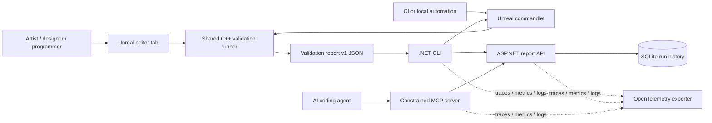

# Architecture

PipelineGuard separates engine-specific validation from portable orchestration. The JSON report is the contract between those halves, so the .NET workflow can be built and tested with fixtures before an Unreal installation or BlackWood repository is available.

## System context



The AI agent is not trusted merely because it is local. MCP arguments are treated as untrusted input and remain behind a narrow application interface.

## Components

### Unreal editor-only plugin

The plugin contains one validation runner and two adapters:

- The editor adapter renders a filterable result list, navigates to an asset, displays remediation, and exports JSON.
- The commandlet adapter selects a configured scope, invokes the same runner, writes JSON, and maps the configured failure threshold to a process exit code.

The adapters must not reimplement validation rules. Given the same project revision, profile, and scope, editor and commandlet runs should produce the same sorted finding set.

The generic profile has four bounded rules:

1. Asset naming prefix by class
2. Allowed or forbidden content path
3. Texture dimension and power-of-two budget
4. DataTable structure and row validation

BlackWood-specific rules belong in a separate project profile or module. They must not leak BlackWood dependencies into the generic core.

### Report contract

The report is a finite snapshot, not a stream. It contains run metadata, summary counters, and actionable findings. Version 1 caps findings at 20,000 and metadata entries at 20 per finding to bound memory, storage, and MCP response costs.

The producer sorts findings deterministically. The consumer validates both JSON Schema constraints and invariants that JSON Schema cannot express. See [report-schema.md](report-schema.md).

### .NET CLI

The CLI is both a report consumer and, when Unreal is installed, a safe process orchestrator. Its responsibilities are:

- Verify a report against the versioned contract.
- Summarize or filter findings for a person or CI log.
- Apply a failure threshold and return the documented exit code.
- Launch an approved Unreal executable with `ProcessStartInfo.ArgumentList`, a timeout, cancellation, and bounded output. The commandlet contract is `-run=PipelineGuard -Report=<path>`.
- Optionally submit a verified report to the API.

The CLI never builds a shell command string from user input.

### ASP.NET report API

The initial API is a local development service rather than a production multi-user service. It binds to loopback by default, validates uploads, enforces a body limit, and stores accepted reports in SQLite. The minimal surface is:

- `POST /api/v1/runs`
- `GET /api/v1/runs`
- `GET /api/v1/runs/{id}`
- `GET /health`

Lists are paginated. Invalid or unsupported report versions receive a client error and are not persisted.

### MCP server

The default MCP surface is read-only:

- `validation_list_runs`
- `validation_get_summary`
- `validation_list_findings`
- `validation_get_remediation`

The server queries the application/API rather than opening arbitrary files. It applies strict input schemas, page and response limits, timeouts, and cancellation. Optional run capability is a separate, default-off feature described in [threat-model.md](threat-model.md).

### Observability

The portable components emit all three OpenTelemetry signals:

- Traces around CLI execution, Unreal process invocation, report ingestion, persistence, and MCP tool calls
- Metrics for run count, duration, and findings grouped only by bounded rule/severity dimensions
- Structured logs carrying the active trace ID

Console export supports a zero-infrastructure demo. OTLP export is opt-in through configuration. Asset paths, report payloads, and run IDs are excluded from metric attributes to avoid high cardinality and accidental disclosure.

## Dependency direction

The intended dependency direction is inward toward contracts and application services:

```text
CLI -------+
API -------+--> application/contracts
MCP -------+
Unreal producer --> JSON contract <-- .NET consumers
```

The contracts layer must not depend on ASP.NET, MCP, OpenTelemetry exporters, SQLite, or Unreal. This keeps fixture tests fast and portable.

## Deployment phases

### Phase 1: portable proof

Build and test contracts, fixtures, CLI behavior, API persistence, telemetry, and read-only MCP on Windows and Linux. No Unreal claim is justified by this phase.

### Phase 2: generic Unreal proof

Compile the plugin in a clean UE 5.6 C++ editor project. Add passing and failing fixture assets for each generic rule. Prove editor/commandlet parity and .NET orchestration.

### Phase 3: BlackWood integration

Inspect actual project data contracts before defining item, dialogue, soft-reference, or physical-surface rules. Record the real assets scanned, rules run, findings, and elapsed time. Intentional exceptions require a reason and must remain visible in the report.

## Deliberate non-goals

The first release includes a local Windows-only BuildGraph compile-and-commandlet
target. It does not include a WPF client, remote identity, automatic content
mutation, LLM calls, Horde, Perforce, or production cloud deployment.
