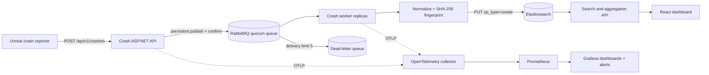

# PipelineGuard Crash Intelligence

Crash Intelligence is an event-driven subsystem inside PipelineGuard. It accepts bounded Unreal crash reports, places them on RabbitMQ, normalizes and fingerprints call stacks in a horizontally scalable worker, and creates idempotent Elasticsearch documents. The React dashboard searches Elasticsearch-backed crash groups by frequency, build, platform, and regression state.

## Architecture



The original validation-report API remains separate and unchanged. Crash Intelligence has its own solution, services, contract, and deployment stack while sharing the repository's .NET 8 engineering standards.

## Processing guarantees

- **Asynchronous acceptance:** the API returns `202 Accepted` only after RabbitMQ confirms a persistent publish to a durable exchange and quorum queue.
- **At-least-once delivery:** a worker failure leaves the message unacknowledged, so RabbitMQ sends it to a surviving or restarted worker.
- **Idempotent effects:** the worker uses `crashId` as the Elasticsearch document ID with `op_type=create`. A replay receives `409 Conflict`, is counted as `duplicate`, and is acknowledged without changing the stored document.
- **Bounded retries:** transient failures use incremental local backoff before they are negatively acknowledged and requeued. The quorum queue's delivery limit is five; exhausted and permanently invalid messages route to `pipelineguard.crash.dead-letter`.
- **Horizontal workers:** RabbitMQ prefetch is bounded and competing consumers share the queue. No in-memory group counter is authoritative.
- **Service recovery:** API and worker readiness includes their dependencies; both reconnect after RabbitMQ or Elasticsearch interruption. Liveness does not fail solely because a dependency is unavailable.

Elasticsearch aggregations calculate group counts and affected builds from immutable crash documents. This avoids a distributed transaction between a crash document and a mutable group counter.

## Stack normalization and grouping

`StackTraceNormalizer` makes symbolized Windows and Linux Unreal frames comparable by:

1. removing call-stack indexes, instruction addresses, module extensions, source paths, line numbers, and symbol offsets;
2. canonicalizing function parameter lists and whitespace;
3. dropping known crash-reporting plumbing frames;
4. retaining the first 12 application frames; and
5. hashing the lower-case error type plus normalized frames with SHA-256.

Messages and memory addresses are not part of the fingerprint. Different top application functions produce different fingerprints. This is deterministic similarity grouping, not probabilistic or ML clustering; unsymbolized stacks require symbolication before ingestion for useful groups.

## Regression status

A group with one occurrence is `new`; an unresolved group with multiple occurrences is `ongoing`. Mark a fixed group through:

```console
curl -X PUT http://127.0.0.1:5080/api/v1/crash-groups/<fingerprint>/resolution \
  -H "Content-Type: application/json" \
  -d '{"resolvedInBuild":"1.4.28","note":"Inventory null guard shipped"}'
```

The API records `resolvedAtUtc`. If the group's latest crash is later than that timestamp, searches automatically return `regression`; otherwise they return `resolved`. This makes the regression rule explicit and auditable instead of inferring release history from incomplete crash traffic.

## Local Linux stack

Requirements are Docker Engine with Compose v2 and approximately 2 GB of available memory.

```console
cp .env.example .env
# Change the local credentials in .env.
docker compose up --build -d
docker compose ps
curl http://127.0.0.1:5080/health/ready
curl -i -X POST http://127.0.0.1:5080/api/v1/crashes \
  -H "Content-Type: application/json" \
  --data-binary @samples/crash-report.json
```

| Service | URL |
| --- | --- |
| Crash dashboard | <http://127.0.0.1:3000> |
| Crash OpenAPI document | <http://127.0.0.1:5080/openapi/v1.json> |
| Swagger UI | <http://127.0.0.1:5080/swagger> |
| RabbitMQ management | <http://127.0.0.1:15672> |
| Elasticsearch | <http://127.0.0.1:9200> |
| Prometheus | <http://127.0.0.1:9090> |
| Grafana | <http://127.0.0.1:3001> |

The default credentials are local-development values only. `.env` is ignored; use a secret manager outside local Compose.

Stop without deleting evidence data using `docker compose down`. Add `--volumes` only when intentionally resetting RabbitMQ, Elasticsearch, Prometheus, and Grafana.

## Search API

```console
curl "http://127.0.0.1:5080/api/v1/crash-groups?project=PipelineGuardHost&build=1.4.27&platform=Linux&status=ongoing&limit=50"
curl "http://127.0.0.1:5080/api/v1/crash-groups?query=Inventory"
curl "http://127.0.0.1:5080/api/v1/crashes/018f6f4d-a5be-7ad3-bd52-8391aef26d8a"
```

The generated OpenAPI document is the HTTP reference. [`unreal-crash-report-v1.schema.json`](../../schemas/unreal-crash-report-v1.schema.json) documents producer limits separately.

## Failure and replay verification

The Node.js 22 verification harness creates semantically equivalent stack variants, records latency percentiles, replays every message, and performs a real worker termination/restart test:

```console
docker compose up --build -d
node scripts/crash-intelligence/verify.mjs --count 10000
```

The default run:

1. publishes 10,000 reports across 100 expected groups;
2. waits for the RabbitMQ queue and Elasticsearch refresh;
3. computes equivalent-stack grouping accuracy;
4. replays all 10,000 reports and verifies that the project index count does not increase;
5. records p50/p95/p99 ingestion and search latency;
6. stops the worker, queues 100 more reports, restarts it, and records recovery time; and
7. writes timestamped JSON under `docs/crash-intelligence/evidence/`.

Use `--skip-recovery` only when the harness cannot control Docker. Run against clean, otherwise idle infrastructure and preserve the generated JSON before making performance or reliability claims.

### Recorded local result

The 2026-08-08 Compose run accepted 10,000 reports, grouped 100% of equivalent variants into the intended 100 groups, replayed all messages with zero duplicate Elasticsearch effects, measured 15.33 ms search p95, and processed 100 reports queued during a worker stop within 9.43 seconds of restart. Ingestion p95 was 3.45 seconds at concurrency 32, so publisher-confirm throughput remains an optimization target rather than a low-latency claim. See the [benchmark summary](evidence/2026-08-08-compose-benchmark.md) and [raw JSON](evidence/benchmark-2026-08-08t13-44-55-844z.json).

## Monitoring

OpenTelemetry traces, metrics, and logs flow through the collector. Prometheus scrapes the collector and RabbitMQ. Provisioned Grafana resources include processing-outcome, queue-depth, p95-latency, duplicate-suppression, and dead-letter panels, plus alerts for a non-empty dead-letter queue and queued work with no consumer.

Metric dimensions are bounded to outcome or reason. Crash IDs, fingerprints, projects, and builds are trace/log fields rather than metric labels to prevent unbounded Prometheus cardinality.

## Kubernetes

[`deploy/kubernetes`](../../deploy/kubernetes/) contains an optional Kustomize base with two API, worker, and dashboard replicas, probes, resource limits, non-root containers, disruption budgets, and one Elasticsearch index replica. RabbitMQ and Elasticsearch are external so production deployments can use their operators or managed equivalents.
